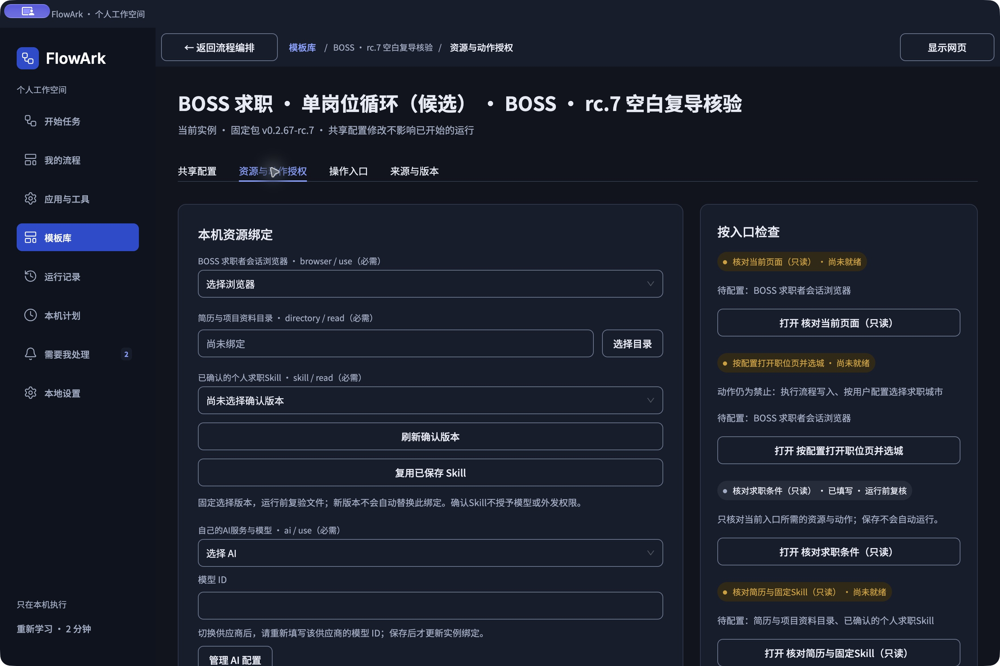

# BOSS 求职 · 单岗位循环 0.2.67-rc.20（候选）

在 FlowArk「模板库」导入本目录的 `.flowark-template.zip`。完整 ZIP 包含 17 个入口、流程、脚本、提示词、Schema、公开资源、工程源码索引和本说明。普通使用不需要解包、Node 或开发环境；导入不会运行，不继承作者的账号、API Key、Skill、目录、历史或动作授权。

**API Key 产生的费用由用户自行承担。** 默认新增招呼预算和回复预算均为 0，动作默认禁止，必须由使用者配置和授权。

## 当前验收范围（2026-11-06）

本轮从空白客户端开始，重新导入资料、访谈、确认保存个人 Skill、绑定本人 Key 和登录，首次建立本工作区自己的安全索引，没有导入旧账号索引。取得两次新招呼的网站成功回执后，同一主流程自动进入消息收尾；首次在网站空未读状态识别处失败。修复后跨日使用原两次证据、关闭新增预算，从主入口恢复，首次固定恢复时的两条真实未读：一条拒绝跳过，一条工作问题按 Skill 生成50字内回复，单次 Enter 取得网站“送达”。集合完整结束，无活动或未知外发；正常退出、重开及再次主入口汇总没有新增发送，索引和集合/进度文件原字节保持。

这是“两次成功→自动切换→修复后恢复收尾→重开防重”的候选证据，**不是全程无中断通过，也不是当天网站150位上限**。真实上限模式保留。本轮未出现新的原生附件、微信、手机号交换或需要回复的 unknown，不阻塞本轮终点，但不登记这些分支实站通过。其他平台、浏览器和所有供应商协议不由本机证据代替。

rc.20 补充明确空未读状态的稳定核对，以及同实例原两次完成证据的跨日收尾恢复。已有集合/进度不重建；结果未知不重发。仅 macOS Apple Silicon、内置浏览器有本轮证据。首次使用20分钟内开始有效任务仍是体验目标，本轮开发构建和修复耗时不冒充该指标已达成。

## 第一次安装和准备资料

1. 从[客户端下载页](https://github.com/zhongmiao-org/flow-ark-client/releases/latest)下载 **0.3.1 或更新版本**，按系统和芯片选择安装包，安装后打开。0.3.0 正式包在已保存 Skill 复用入口合并前切出，不满足本包的首次使用引导。本轮实际验收 macOS Apple Silicon；发布页有其他平台产物不代表其 BOSS 业务已验收。macOS 包尚未签名／公证，系统要求本人处理的安全或登录步骤须由本人完成。普通使用只需要客户端和模板 ZIP，不需要源码、Node、终端或另行下载自动化浏览器；缺少能力或版本不足时先更新客户端。
2. 准备一个自己的资料目录，放入已核对的简历 PDF、项目说明等。资料和输出都保存在本机，不要将自己的文件放进公开模板。PDF 必须有可提取文本；扫描件、缺字或超预算不能假装已经完整读取。
3. 准备一个独立的沟通缓存目录，用于安全索引、固定会话集合、进度和附件账本。真正首次使用本机客户端、实例与缓存均无本地历史时，可以建立自己的空索引，即使网站账号以前与人沟通过，也不要求导入作者或其他工作区的记录。已有本地外发历史但索引丢失时会停止，不能靠换空目录规避；空索引不证明网站没有历史，网站已沟通岗位及本地已发/预留/unknown仍跳过。
4. 在网站由本人登录 BOSS 求职者账号，完成验证码等真人步骤。默认使用 FlowArk 内置浏览器，页面从客户端右上角入口打开；本机浏览器需要在当前实例资源中另行明确选择。浏览器全局设置不等于已经为这个实例绑定。

## 先检查个人 Skill，有则复用，无则访谈

个人蒸馏与 BOSS 是两个独立模板。需要访谈或更新时，取得[个人蒸馏模板](https://github.com/zhongmiao-org/flow-ark-templates/tree/main/templates/personal-distillation)目录中的完整 ZIP，在模板库导入并创建自己的实例；已有确认版本可直接在 BOSS 资源中复用，不必为此新建访谈实例。BOSS ZIP 不夹带作者的个人 Skill。

先检查自己的简历仓库／资料目录是否已有 `flowark-skills` 下的确认版本，以及客户端资源页的「已确认个人 Skill」列表。已有可核验的确认版本时，选择准确版本并核对文件后直接复用，不为了导入 BOSS 重做访谈或重新付费。普通 Markdown 草稿不自动成为已确认版本。已经有文件但新客户端列表为空时，点资源选择器旁的「复用已保存 Skill」，通过系统选择器选择自己 `flowark-skills/<key>/<versionId>/manifest.json`。对照标题、原确认时间、完整正文、结构化资料与来源及摘要，由本人勾选核对后点「核对无误，复用此版本」。原文件、版本、父版本、摘要和确认时间保持；已有当前版本不替换。保存资源后才能用于运行，不调用模型。只登记所选版本，不扫描全目录；文件缺失、摘要不符或核对后变化会停止并保留原绑定。客户端没有这个按钮时先更新包含此能力的客户端，不手填版本 ID、插数据库或重做访谈。

没有可复用版本时，按个人蒸馏模板引导操作：

1. 在「参数与资源」选择自己的「简历与项目资料」目录，填写 1–10 份相对文件名，先运行「核对所选资料」。不会扫描整个仓库或运行项目代码。
2. 配置下文的本人 AI 服务，运行「持续访谈与补充资料」。在「需要我处理」中回答经历、偏好、表达习惯和边界；未知内容保持待确认。没有补充时直接进入整理，不强迫继续回答。
3. 从「完整访谈来源」核对并固定全部来源，到「整理完整来源并生成待确认Skill」选择这份来源。最近聊天窗口不能替代完整访谈记录。
4. 在结果中的来源整理进度核对下一批，每批最多 8 次请求；失败或 unknown 先查看原请求，有完整响应时优先零调用采用。不自动更换服务或付费重试。
5. 在「需要我处理」阅读、编辑和内部试聊，最后由本人确认保存。只有实际写出并登记成功，才算有可供 BOSS 选择的确认版本。生成草稿、确认来源和最终保存是不同操作。

保存位置可选自己的资料目录或另一个明确目录。后续可继续原会话补充，核对差异后保存新版本；旧版本、旧 Run 和 BOSS 现有绑定不会自动改成新版。完整步骤和限制以个人蒸馏包内 README 为准。

此前已在独立工作区通过普通 UI 复用确认版本；本轮另从自己的资料重新完成访谈、草稿修改、本人确认和新 Skill 保存，再由 BOSS 显式绑定。已有版本可复用；没有版本时按上述步骤访谈，不要求恢复作者的 Skill 或历史。

## 配置自己的 API Key

打开「本地设置」中的 AI 服务配置，选择实际供应商，保存自己的 API Key 和模型；再到各实例的「参数与资源」为「本人 AI 服务」选择该服务并保存。Key 由客户端保护存储，不要粘贴到聊天、提示词、简历、README 或脚本中。资源缺失或服务失败时停止，不静默切换供应商／模型。

**API Key 产生的费用由用户自行承担。** 访谈、完整来源整理、内部试聊、JD 建议和工作问题回复都可能产生费用；失败、取消和未知结果也可能已计费，未报告用量不能算零费用。重试是另一次可能收费的操作，须核对原请求与本次范围。首次招呼阶段和原生附件入口不调用 AI；主入口处理unknown或在真实上限／明确两次测试终点后回复工作问题时，会使用本人已配置的AI服务并可能产生费用。聊天快照未变化时优先复用已有模型结果；聊天或确认事实变化可能产生新的请求费用。

## 导入 BOSS 并配置基础信息

1. 模板库 → 导入 ZIP 模板 → 选择本包 → 核对来源、版本、能力与说明 → 安装 → 创建自己的实例。保持默认禁止，配置过程不会外发。
2. 打开实例「参数与资源」，可在「本人已确认的补充事实（可选）」维护本人确认的新事实或纠正，例如学历类别及可核查性。此项默认空，仅保存在自己的实例，与确认Skill共同供模型使用，不授予外发权限，也不覆盖原Skill版本；不要填写Key。然后分别填写「网站检索词」和必填的「可接受岗位标题关键词」（1–20 项），再填城市、期望月薪上下限（元/月）、排除项和回复额度并保存。例如只接受标题明确写有前端的岗位，可将标题允许词填为 `前端`；检索词可填 `Vue前端` 等。标题允许词按完整实际岗位标题作 NFKC／大小写归一化后的字面匹配，至少命中一项，排除项优先。不会使用 JD 正文、技术标签或搜索命中证明合格；想接受其他表述时须由本人明确加入允许词，不自动放宽。标题缺失、截断或来源变化时停止。首次招呼另按左侧月薪区间交集（包含端点）、排除项及选中状态处理，不比较左右公司名称，不调用 AI 判断资格。无法明确换算月薪则跳过。排除项还在完整标题与左侧卡片中匹配，并在预留前、最终点击前复验；可填写本人不接受的校招、应届、全栈、Android／React Native、短期等方向。正向标题检查与排除项互相补充，均不能代替完整 JD 判断。
3. 绑定当前会话浏览器、自己的资料目录、沟通缓存目录和已确认个人 Skill 的准确版本。需要访谈、工作问题回复或内部 AI 建议时绑定自己的 AI 服务。文件名填相对资料目录的文件名，不填作者路径。
4. 依次运行「核对求职条件（只读）」「核对简历与固定Skill（只读）」。在网站职位列表手动选中岗位后，先运行「只读核对岗位范围」，核对完整标题、准确岗位链接、允许词和排除原因；该入口不点击沟通、不创建外发意图、不调用 AI，也不代替城市、薪资和账号核验。登录后运行「核对当前求职账号（本人确认）」，对照真实账号页面确认；再回到资源页明确选择这次保存的账号结果。新实例不继承旧实例的账号确认。
5. 运行「核对或首次建立账号安全索引（本人确认）」。已有索引只核对；本实例或绑定缓存已有本地历史而索引缺失时仍停止，不能通过首次初始化清除或覆盖。当前实例与所选缓存均无本地历史时，可在待回答请求中明确确认本工作区首次使用并建立本地空索引；账号可以有网站既往沟通，不要求恢复旧数据。空索引不代表网站无历史或旧unknown已完成；仍跳过网站已沟通项，每次外发先预留并核对回执。初始化也须预留并读回，不能覆盖旧文件。
6. 在 BOSS App 设置并保存自己的默认招呼语，把完整正文填入主入口对应参数。网页「消息通知 → 设置招呼语」只能核对启用状态，不能自定义或读取 App 正文。网页空白不代表未配置。每条实际发送后还要核对完整正文，不得缩写或补发另一条介绍。
7. 在主入口填写资料文件名、城市序号、单批检查数量、首次沟通运行配置和完整招呼语，保存。逐项核对选城、浏览岗位、状态写入、缓存写入和首次沟通权限；首次沟通授权不包含回复、附件或联系方式。

## 主流程和运行结果

条件／资料核对 → 本人确认并绑定账号 → 安全索引核对 → App 默认招呼准备 → 每日循环打招呼 → 查看结果和待办。

连续使用时在运行前选择「连续运行有限批次」，核对批数、时限和批间等待；修改设置后点「核对连续设置」。单批检查数量只是本地调度边界，连续 20 次是历史验收标准，均不是网站的发送上限。

「每日打招呼额度」为 0 时禁止新招呼；150 是按网站真实当天上限运行的模式，本地计数达到 150 不会被伪装成网站上限；其他支持的有限正值按本地保守额度停止。共享字段 `firstContactDailyBudget` 为0–150整数，默认0；它独立限制账号、时区、当日的confirmed、reserved与unknown占额，预留前及点击前复核，不能靠批数替代。预算耗尽不伪造网站上限，也不阻止已触发的消息收尾。

动作选择「每次确认」时，客户端会在首次写入前请求对当前 Run 的授权，范围包含该 Run 内后续循环；它不是仅确认一次点击。具体外发操作还须按原去重键独立准备。本轮可以先使用单项小批核对；确认请求超时会停止，不会自动重放。配置范围内自动执行也只覆盖已批准的动作，附件、联系方式和重要承诺仍需单独授权。

岗位循环：读当前位置 → 筛左侧月薪交集 → 点击卡片并确认选中 → 关闭、已沟通、仅有立即网申、未命中标题允许词或命中排除项则跳过 → 核对账号和外发历史 → 持久预留并读回 → 点击一次立即沟通 → 核对网站「已向BOSS发送消息」及批准的完整正文 → 留在此页 → 保存确认后继续。按钮可能仍暂时显示立即沟通，不能再次点击。不会逐岗位进入聊天或补发详细介绍。

列表处理完才触底增量加载；正常加载后没有新增才换配置检索词，全部耗尽记录原因停止。正式模式在真实网站当天上限提示后进入固定未读消息收尾，候选耗尽、本地计数和普通Run结束不能冒充上限。测试可将共享字段 `acceptanceNewGreetings` 从默认0改为2：启动前固定已有占额基线，日预算仅允许再新增两次占额；两次新confirmed后由同一主流程后续批次自动固定未读，单独保存测试来源，不写成网站上限。仅支持0或2，未知操作不自动补足。固定集合只处理当时的一轮，不追逐持续新增会话；我方已回复、本人接管、拒绝、不合适、等待或普通客套跳过。消息收尾不再重新核对公司、打开岗位详情或重筛城市薪资；当前聊天明确校园仍排除。首次招呼阶段的完整标题、排除优先、城市薪资和账号守卫保持。对方主动发起的会话直接跳过，不用岗位不匹配反推谁先联系。仅尚未回答的工作问题使用自己的 AI，发前重读当前账号、聊天消息链及原入站编号，核对唯一预留和完整草稿，等待发送控件可用且两个样本稳定、点击输入框取得可信焦点并复验后只按一次Enter，再核对送达；不点击发送按钮、不自动补按。请求简历时走原生同意、准确选件、单次发送及回执核对；微信或手机号请求分别原生同意，不另在聊天文字写出手机号。取得真实微信号后保存联系人及来源提醒，不猜账号、不自动加好友。问题回复按已确认Skill与上下文，包含标点空格最多50个Unicode字符，发送前再次校验。缺事实、重要承诺、对象不明保留待办。同会话多个有效请求分别防重，不以一个动作完成代替其他动作。原生分支本轮尚未实际触发，不能写成通过。同会话多请求分别执行及登记，读取到真实微信号才建立带联系人与来源的提醒；同意交换不等于已取得号码。

### 主入口恢复原收尾

需要恢复以前的真实上限收尾时，在主入口勾选「仅恢复既有消息收尾（不打新招呼）」，默认关闭。必须有当前账号原收尾指针、原日期真实上限、固定集合与完整进度；缺少则停止，不改日期、不制造今天的上限、不扫描新增会话。已完成成员只汇总，未完成成员仍需原回复授权。该模式已在主入口读回原 9 项并正常结束：1 条历史确认、8 条跳过、0 项待处理，没有新操作意图或模型调用。它不代替新一轮达到上限后的首次自动切换验收。

## unknown 的 AI 接管与防重

unknown表示程序没有取得可靠的完成回执，不代表一定没发。启动已授权的主入口后，先按当前账号读取安全索引、附件账本和已有接管结论；将本批待核对记录固定下来，不新增招呼，不无限追逐后来消息。按网站真实消息编号读取对应聊天，结合确认Skill、完整可见上下文和本人已确认事实，使用自己的API判断：

- 已有回答、明确拒绝、不合适或客套：登记跳过，不补发致谢。
- 仍有未回答的工作问题：只说明有事实依据的内容，最多50字；原unknown保留，另建关联原记录的唯一接管预留，同一原来信不新建无穷恢复链。等待发送就绪、复核正文和会话后只按一次Enter，以同会话新增消息编号及送达／已读回执确认。
- 已见附件发送／查看回执：记录独立核验，不重发。模型认为“可能没发”不能代替网站结果；仍无法核实的原生附件操作保留原请求与记录，不凭AI猜测重新发送。
- 关键事实、原服务器消息、账号或准确会话不可读取：保留明确原因，不编造收件人、经历或结果。来信措辞不明确本身会交由AI判断，不因此直接停在待办。

新回复在外发前自动将当前会话定位、原来信和批准草稿保存在本人沟通缓存；发生unknown后可直接读取。早期版本没有定位来源的旧记录，尝试在当前已加载的既有会话列表中按原消息编号查找，找不到时保留原因；不冒充已读完整历史、不用同公司或同名替代原消息。普通模式不删除旧记录，不靠空缓存、新实例或更换浏览器绕过防重。

接管结果与原副作用历史分别保留。已有接管预留或接管本身再次unknown时，先重读真实聊天；不因生成一份新文案或改变操作键而再次发送。恢复权限仍来自使用者在客户端的明确动作授权，模板、Skill和模型判断都不能扩大授权。

## 主流程中的原生简历与联系方式

先由本人在BOSS维护并确认最新附件的完整名称，填入主入口的简历文件名。主流程在当前聊天读取真正的原生附件请求，按账号、原消息链和请求编号检查原账本，保留全部confirmed／reserved／unknown；新请求先持久预留，再原生“同意—准确选件—发送”，核对同会话新增服务器消息与附件回执。不离开聊天查询公司、岗位或附件管理页，不上传本地PDF，不默认选择第一份附件，不删除或改名网站文件。选件歧义、原请求变化、未取得回执都保留记录停止，不自动重试。

微信、手机号只处理对方在该聊天主动提出且尚未处理的原生交换请求，分别预留、同意一次并核对回执。手机号不另拼进聊天文字；实际读到微信号后才保存带联系人及来源的本地提醒，不猜号、不自动加好友。与文字问题可分别处理，每个请求只执行一次。

以上分支公开默认禁止，须由使用者明确授权范围；本轮没有新可执行请求，代码和语法检查不代替真实回执。独立「核对请求并原生发送现有附件」辅助入口仍保留原严格核验与历史防重，用于已有手动核验，不作为本次主流程自动收尾的入口。

### 恢复已保存的两次测试集合

普通使用将「原测试收尾证据文件名」留空。恢复同一实例以前的两次测试时，填写原缓存中的 completion 证据文件名，关闭新增招呼预算，并开启主入口「仅恢复既有消息收尾」。核对原账号、实例、两次完成证据、原基线及安全索引；原集合与进度存在时只恢复，不扫描新成员。如果两次已确认、但失败发生在第一次固定集合之前，允许首次固定恢复时的真实未读，保存准确捕获时间及原招呼日期，不冒充原日期集合。只有集合或进度缺一、摘要冲突、unknown或活动来源未核对时停止。此模式不新增招呼，不重新计算新日“两次”基线；已完成成员不重放。

## 17 个入口

| 入口 | 用途 |
| --- | --- |
| 只读核对岗位范围 | 核对当前选中岗位的完整标题与准确链接，输出允许词／排除结果；无外发、无 AI |
| 核对求职条件（只读） | 检查已保存条件，不调用网站或模型。 |
| 核对简历与固定Skill（只读） | 核对资料和准确确认版本；可读不等于事实一致。 |
| 核对当前求职账号（本人确认） | 生成可显式绑定的本人账号来源。 |
| 核对或首次建立账号安全索引（本人确认） | 保留历史；本机实例与缓存均无本地历史可明确首次建立空索引，不要求网站账号从未沟通。 |
| 核对当前页面（只读） | 读取页面证据；缺登录提示不证明登录有效。 |
| 按配置打开职位页并选城 | 采用配置并读回网站实际城市。 |
| 每日循环打招呼（制作中） | 先处理待核对unknown，再按原规则首次招呼、增量加载及上限／两次测试路由。 |
| 上限后固定未读消息收尾 | 读取真实上限及固定集合，逐项保守处理和恢复，不新建招呼。 |
| 核对请求并原生发送现有附件 | 本人确认网站现有附件，原生单次发送及原记录防重。 |
| 核对当前网页JD来源（只读） | 核对岗位、网址和元数据。 |
| 核对网页JD正文（本人确认） | 对照完整正文，缺失或来源变化不采用。 |
| 评估当前网页JD方向（本人核对后） | 核对来源后生成内部建议。 |
| 评估JD与求职方向（建议） | 根据输入 JD 生成内部建议。 |
| 处理来信与回复草稿（仅内部） | 内部草稿，不代表正式回复已发送。 |
| 会话接管与内部草稿恢复 | 管理内部接管状态，不扩大外发授权。 |
| 回复前核对（制作检查点） | 检查缺口，不单独授权发送。 |

## 停止、恢复和当前验收范围

「本批结束后停止」让当前批安全收尾并阻止后续批次；立即取消可能留下待核对外发。confirmed 表示有确认回执，reserved 是预留，unknown 是结果未知。点击、待办已读和 Run 完成都不是业务成功。重开、取消、升级和换实例均不清除防重；安全索引缺失、来源变化、容量不足或保存失败时保留数据停止。

已有实站证据：同一连续会话 22 条新招呼；网站真实 150 位上限，148 条账本确认与 2 条历史 unknown 分开；固定 9 会话中 1 条工作问题回复确认、8 条跳过；准确 PDF 一次上传及一次授权发送，从同一回执打开的三页内容已独立核对。原附件上传和发送 unknown 均保留，独立核验 confirmed 另存；再次运行无新上传、消息或操作意图。

历史附件的「确定添加」曾由人工完成，原上传与发送 unknown 均保持；该证据不代表首次上传全自动通过。本轮依本人要求改为使用本人确认的 BOSS 现有附件及原生发送功能，停用自动上传。本轮两次测试自动切换已取得证据；消息收尾经过修复后恢复，不能描述为全程无中断。真实上限首次切换和原生附件、微信、手机号链路仍待实站验收；未完成项不能因语法检查或导入通过而勾选。CPU 峰值、所有异常恢复和其他平台仍须分别验证。全新客户端的既有 Skill 登记与首次导入配置已有独立工作区证据；没有原 Skill 时的付费访谈按个人蒸馏模板单独执行。联系方式交换和重要承诺不在已通过范围。Firefox／Safari／Windows 不能由本机内置浏览器证据代替。

作者可通过本轮客户端的「本地流程工程」、安装包 CLI/配对 MCP 或 AI 开发通道维护工程，再由同一正式编译器导出标准 ZIP；既有模板作者 UI 继续可用。源码位于仓库 development/boss-job-search；开发需包含该入口的本轮安装候选，不能只凭旧0.3.1版本号判断具备工程能力。公开包不携带本机绑定与授权；包内外 README 应逐字节一致。业务记录、Key、登录态、Skill 与私人截图保留在自己的本机。

## 配置界面截图

下图来自官方客户端 0.3.1 中 rc.7 空白复导实例，rc.20沿用相同资源配置表单；这张历史截图不证明新分支已通过。截图仅含公开模板与未填写字段，没有私人简历、联系人或 Key；原图随包保存在同级 assets 目录。

在「资源与动作授权」选择浏览器和自己的资料目录；已有确认 Skill 可点击「复用已保存 Skill」，没有版本时按前文访谈引导生成。AI 服务选择自己的供应商与模型，通过「管理 AI 配置」维护 Key。每个入口分别显示缺少的资源与授权，保存不会自动执行。

原生附件入口另填本人已在 BOSS 确认的网站现有附件完整文件名。它只需要浏览器、准确账号来源和沟通缓存，不要求本地 PDF 或 AI；缺少资源或授权时运行按钮不可用。

## 本地工程开发（可选）

普通用户完成上面的资料、Skill、Key、浏览器和基础配置即可使用，不需要开发工具。作者打开 `development/boss-job-search` 中的 `flowark.project.json`；Mermaid 稳定区块 ID 对应 `nodes/` 参数及 `scripts/` JS/TS。常量、默认配置和 Schema 分别位于 `config/constants.json`、`config/defaults.json` 和 `schemas/`；私人实例值、绑定、登录、受保护 Key、`.flowark/`、真实 env 及运行历史不随 ZIP 公开。

安装包 CLI/MCP 用法见客户端 README。先读取安装版本的规范、节点目录、SDK 和配置规则，再按修订修改/校验。运行必须通过客户端完整核对；同 Schema/资源/权限边界的显式重建保留实例与历史，边界变化使用新的默认禁止实例。运行中源码或开发配置变化只影响下次运行。ZIP 由正式工程打包工具生成后原样登记摘要，禁止手改归档。
