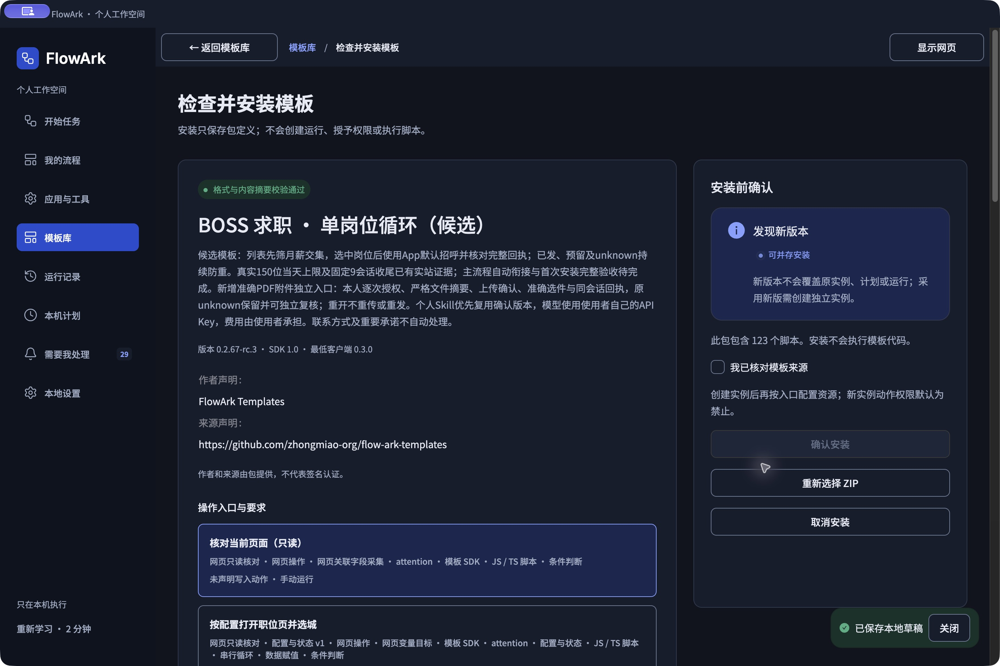

# BOSS 求职 · 单岗位循环 0.2.67-rc.5（候选）

在 FlowArk 的「模板库」导入本目录唯一的 `.flowark-template.zip`。ZIP 包含全部 16 个入口、流程、脚本、提示词、字段结构、公开资源、作者编辑信息和本说明，不需要解包或安装脚本依赖。导入不会运行流程，也不会继承作者的账号、API Key、个人 Skill、本机目录、历史记录或动作授权。

当前为开发候选。真实当天 150 位沟通上限、固定 9 会话收尾、主入口恢复既有真实上限记录和一次准确 PDF 附件发送已有实站证据；新一轮上限首次自动切换、新版附件从首次上传到发送的全程自动执行、首次安装完整闭环仍待验收。业务证据和剩余范围见[治理记录](https://github.com/zhongmiao-org/flow-ark/blob/main/docs/templates/boss-single-job-loop.md)。不要把安装成功或运行结束当作已投递。

## 第一次安装和准备资料

1. 安装维护者提供的 macOS Apple Silicon FlowArk 客户端，拖入「应用程序」后打开。当前客户端为 0.3.0 开发候选，尚未正式签名、公证或建立正式下载渠道；安装包及适用平台以维护者交付为准。普通使用只需要客户端和模板 ZIP，不需要源码、Node、终端或另外下载自动化浏览器。导入检查提示缺少能力时先更新客户端。
2. 准备一个自己的资料目录，放入已核对的简历 PDF、项目说明等。资料和输出都保存在本机，不要将自己的文件放进公开模板。PDF 必须有可提取文本；扫描件、缺字或超预算不能假装已经完整读取。
3. 准备一个独立的沟通缓存目录，用于账号安全索引、网站上限、固定会话集合、进度和附件防重账本。曾经自动外发的账号必须恢复原安全索引和历史，再开始使用。删除客户端流程、待办或运行记录不表示网站没有发出消息；不要用空目录、新实例或另一浏览器规避历史。
4. 在网站由本人登录 BOSS 求职者账号，完成验证码等真人步骤。默认使用 FlowArk 内置浏览器，页面从客户端右上角入口打开；本机浏览器需要在当前实例资源中另行明确选择。浏览器全局设置不等于已经为这个实例绑定。

## 先检查个人 Skill，有则复用，无则访谈

个人蒸馏与 BOSS 是两个独立模板。需要访谈或更新时，取得[个人蒸馏模板](https://github.com/zhongmiao-org/flow-ark-templates/tree/main/templates/personal-distillation)目录中的完整 ZIP，在模板库导入并创建自己的实例；已有确认版本可直接在 BOSS 资源中复用，不必为此新建访谈实例。BOSS ZIP 不夹带作者的个人 Skill。

先检查自己的简历仓库／资料目录是否已有 `flowark-skills` 下的确认版本，以及客户端资源页的「已确认个人 Skill」列表。已有可核验的确认版本时，选择准确版本并核对文件后直接复用，不为了导入 BOSS 重做访谈或重新付费。普通 Markdown 草稿不自动成为已确认版本。已经有文件但新客户端列表为空时，点资源选择器旁的「复用已保存 Skill」，通过系统选择器选择自己 `flowark-skills/<key>/<versionId>/manifest.json`。对照标题、原确认时间、完整正文、结构化资料与来源及摘要，由本人勾选核对后点「核对无误，复用此版本」。原文件、版本、父版本、摘要和确认时间保持；已有当前版本不替换。保存资源后才能用于运行，不调用模型。只登记所选版本，不扫描全目录；文件缺失、摘要不符或核对后变化会停止并保留原绑定。客户端没有这个按钮时先更新包含此能力的客户端，不手填版本 ID、插数据库或重做访谈。

没有可复用版本时，按个人蒸馏模板引导操作：

1. 在「参数与资源」选择自己的「简历与项目资料」目录，填写 1–10 份相对文件名，先运行「核对所选资料」。不会扫描整个仓库或运行项目代码。
2. 配置下文的本人 AI 服务，运行「持续访谈与补充资料」。在「需要我处理」中回答经历、偏好、表达习惯和边界；未知内容保持待确认。没有补充时直接进入整理，不强迫继续回答。
3. 从「完整访谈来源」核对并固定全部来源，到「整理完整来源并生成待确认Skill」选择这份来源。最近聊天窗口不能替代完整访谈记录。
4. 在结果中的来源整理进度核对下一批，每批最多 8 次请求；失败或 unknown 先查看原请求，有完整响应时优先零调用采用。不自动更换服务或付费重试。
5. 在「需要我处理」阅读、编辑和内部试聊，最后由本人确认保存。只有实际写出并登记成功，才算有可供 BOSS 选择的确认版本。生成草稿、确认来源和最终保存是不同操作。

保存位置可选自己的资料目录或另一个明确目录。后续可继续原会话补充，核对差异后保存新版本；旧版本、旧 Run 和 BOSS 现有绑定不会自动改成新版。完整步骤和限制以个人蒸馏包内 README 为准。

已在独立空白工作区从零导入并通过普通 UI 复用原确认版本，自己的简历 PDF 与固定 Skill 的只读核对已通过。首次保存全新 API Key、本人网站登录及后续账号/动作配置须由使用者完成；这些步骤不能由模板替本人确认。

## 配置自己的 API Key

打开「本地设置」中的 AI 服务配置，选择实际供应商，保存自己的 API Key 和模型；再到各实例的「参数与资源」为「本人 AI 服务」选择该服务并保存。Key 由客户端保护存储，不要粘贴到聊天、提示词、简历、README 或脚本中。资源缺失或服务失败时停止，不静默切换供应商／模型。

**API Key 产生的费用由用户自行承担。** 访谈、完整来源整理、内部试聊、JD 建议和工作问题回复都可能产生费用；失败、取消和未知结果也可能已计费，未报告用量不能算零费用。重试是另一次可能收费的操作，须核对原请求与本次范围。首次招呼和准确 PDF 附件入口不调用 AI。

## 导入 BOSS 并配置基础信息

1. 模板库 → 导入 ZIP 模板 → 选择本包 → 核对来源、版本、能力与说明 → 安装 → 创建自己的实例。保持默认禁止，配置过程不会外发。
2. 打开实例「参数与资源」，填写检索词、城市、期望月薪上下限（元/月）、排除项和回复额度，再保存。首次招呼仅按左侧月薪区间交集（包含端点）及岗位选中状态处理，不比较左右公司名称，不让 AI 判断首次招呼资格。无法明确换算月薪则跳过。
3. 绑定当前会话浏览器、自己的资料目录、沟通缓存目录和已确认个人 Skill 的准确版本。需要访谈、工作问题回复或内部 AI 建议时绑定自己的 AI 服务。文件名填相对资料目录的文件名，不填作者路径。
4. 依次运行「核对求职条件（只读）」「核对简历与固定Skill（只读）」。登录后运行「核对当前求职账号（本人确认）」，对照真实账号页面确认；再回到资源页明确选择这次保存的账号结果。新实例不继承旧实例的账号确认。
5. 运行「核对或首次建立账号安全索引（本人确认）」。已有索引只核对；有历史而索引缺失会停止，需恢复旧索引。只有此账号从未自动外发时，才能在待回答请求中明确选择首次建立，默认保留历史并停止。初始化也须预留并读回，不能覆盖旧文件。
6. 在 BOSS App 设置并保存自己的默认招呼语，把完整正文填入主入口对应参数。网页「消息通知 → 设置招呼语」只能核对启用状态，不能自定义或读取 App 正文。网页空白不代表未配置。每条实际发送后还要核对完整正文，不得缩写或补发另一条介绍。
7. 在主入口填写资料文件名、城市序号、单批检查数量、首次沟通运行配置和完整招呼语，保存。逐项核对选城、浏览岗位、状态写入、缓存写入和首次沟通权限；首次沟通授权不包含回复、附件或联系方式。

## 主流程和运行结果

条件／资料核对 → 本人确认并绑定账号 → 安全索引核对 → App 默认招呼准备 → 每日循环打招呼 → 查看结果和待办。

连续使用时在运行前选择「连续运行有限批次」，核对批数、时限和批间等待；修改设置后点「核对连续设置」。单批检查数量只是本地调度边界，连续 20 次是历史验收标准，均不是网站的发送上限。

岗位循环：读当前位置 → 筛左侧月薪交集 → 点击卡片并确认选中 → 关闭或已沟通则跳过 → 核对账号和外发历史 → 持久预留并读回 → 点击一次立即沟通 → 核对网站「已向BOSS发送消息」及批准的完整正文 → 留在此页 → 保存确认后继续。按钮可能仍暂时显示立即沟通，不能再次点击。不会逐岗位进入聊天或补发详细介绍。

列表处理完才触底增量加载；正常加载后没有新增才换配置检索词，全部耗尽记录原因停止。真实网站当天上限提示才进入固定未读消息收尾，候选耗尽、本地计数和普通 Run 结束不能冒充上限。固定集合只处理当时的一轮，不追逐持续新增会话；我方已回复、本人接管、拒绝、不合适、等待或普通客套跳过。仅尚未回答的工作问题使用自己的 AI，发前重读、预留、单次发送并核对送达。附件、联系方式和重要承诺另行处理。主入口已通过恢复原真实上限及已完成集合的限定核验；新一轮上限首次自动切换仍待验证，不以独立收尾入口完成代替。

### 主入口恢复原收尾

需要恢复以前的真实上限收尾时，在主入口勾选「仅恢复既有消息收尾（不打新招呼）」，默认关闭。必须有当前账号原收尾指针、原日期真实上限、固定集合与完整进度；缺少则停止，不改日期、不制造今天的上限、不扫描新增会话。已完成成员只汇总，未完成成员仍需原回复授权。该模式已在主入口读回原 9 项并正常结束：1 条历史确认、8 条跳过、0 项待处理，没有新操作意图或模型调用。它不代替新一轮达到上限后的首次自动切换验收。

## 发送对方请求的准确 PDF 附件

这是独立的「核对请求并发送准确PDF简历」入口，默认禁止，须本人对准确联系人、岗位和文件逐次授权。先在网页打开正确会话，确认存在唯一未处理的附件请求。入口参数只填写资料目录中的准确 PDF 相对文件名；不会拿附件库里的旧简历代替。

流程核对账号、会话、原请求消息编号、关联岗位城市／薪资与来源、接管状态和历史账本，再读取本地 PDF 的完整摘要与大小。第一次上传单独持久预留，通过原生上传读取所选文件，二次提取摘要确认未变；核对网站附件预览的全名、KB 大小和 PDF 格式后点击一次「确定添加」，再读回本人附件库。上传成功不代表招聘方已收到。

发送前再次独立预留，回到同一请求会话。网站有多个附件时，必须选中完整名称一致的准确文件并在最终点击前复核选中状态；不选择默认第一项。发送一次后核对同会话新增的服务器消息编号和网站附件发送回执。网站可能把长文件名缩为省略号；只有与发送前的准确选件、已验证文件摘要和新增回执一起核对才可采用，不能单靠相似前缀判断文件相同。

超时、取消或回执不明确时保留原 reserved／unknown，不重新上传或发送。必要时从原回执的「点击查看附件」打开预览，核对完整内容和原运行记录；经本人明确核对后另存独立观察，不改写原 unknown。重开已核对的请求只汇总已有送达，新增上传和消息均为零。拒绝发送的请求保留待办，不为了验收换其他联系人外发。

## 16 个入口

| 入口 | 用途 |
| --- | --- |
| 核对求职条件（只读） | 检查已保存条件，不调用网站或模型。 |
| 核对简历与固定Skill（只读） | 核对资料和准确确认版本；可读不等于事实一致。 |
| 核对当前求职账号（本人确认） | 生成可显式绑定的本人账号来源。 |
| 核对或首次建立账号安全索引（本人确认） | 保留历史；从未外发的新账号才可明确首次初始化。 |
| 核对当前页面（只读） | 读取页面证据；缺登录提示不证明登录有效。 |
| 按配置打开职位页并选城 | 采用配置并读回网站实际城市。 |
| 每日循环打招呼（制作中） | 首次招呼、增量加载与上限路由候选主线。 |
| 上限后固定未读消息收尾 | 读取真实上限及固定集合，逐项保守处理和恢复，不新建招呼。 |
| 核对请求并发送准确PDF简历 | 独立授权的准确附件链路和原发送复核。 |
| 核对当前网页JD来源（只读） | 核对岗位、网址和元数据。 |
| 核对网页JD正文（本人确认） | 对照完整正文，缺失或来源变化不采用。 |
| 评估当前网页JD方向（本人核对后） | 核对来源后生成内部建议。 |
| 评估JD与求职方向（建议） | 根据输入 JD 生成内部建议。 |
| 处理来信与回复草稿（仅内部） | 内部草稿，不代表正式回复已发送。 |
| 会话接管与内部草稿恢复 | 管理内部接管状态，不扩大外发授权。 |
| 回复前核对（制作检查点） | 检查缺口，不单独授权发送。 |

## 停止、恢复和当前验收范围

「本批结束后停止」让当前批安全收尾并阻止后续批次；立即取消可能留下待核对外发。confirmed 表示有确认回执，reserved 是预留，unknown 是结果未知。点击、待办已读和 Run 完成都不是业务成功。重开、取消、升级和换实例均不清除防重；安全索引缺失、来源变化、容量不足或保存失败时保留数据停止。

已有实站证据：同一连续会话 22 条新招呼；网站真实 150 位上限，148 条账本确认与 2 条历史 unknown 分开；固定 9 会话中 1 条工作问题回复确认、8 条跳过；准确 PDF 一次上传及一次授权发送，从同一回执打开的三页内容已独立核对。原附件上传和发送 unknown 均保留，独立核验 confirmed 另存；再次运行无新上传、消息或操作意图。

本轮附件曾由人工完成网站「确定添加」，发送由流程执行；新代码已补齐添加确认和缩略回执关联，但没有再次上传／发送来重复验收。因此尚不能宣布新版从首次上传开始的全自动链路通过。新一轮真实上限后的首次自动切换、CPU 峰值、所有异常恢复、全新客户端既有 Skill 登记及完整首次使用仍待完成。联系方式交换和重要承诺不在已通过范围。Firefox／Safari／Windows 不能由本机内置浏览器证据代替。

作者在模板制作工作区维护入口、字段、资源、动作和公开文件，通过编排副本及专用脚本编辑器修改，核对带回后导出一个标准 ZIP。公开包不携带本机绑定与授权；包内外 README 应逐字节一致。业务记录、Key、登录态、Skill 与私人截图保留在自己的本机。

## 配置界面截图

以下为客户端实际界面，截图取自 rc.3 的导入核对页，rc.5 沿用这个入口。截图只含公开模板与空白配置，不含私人简历、联系人或 Key；原截图随包保存在 assets 中。

导入时先核对来源和能力，再安装：

附件入口只填写所绑定资料目录中的准确 PDF 相对文件名；缺少资源或授权时运行按钮不可用：
